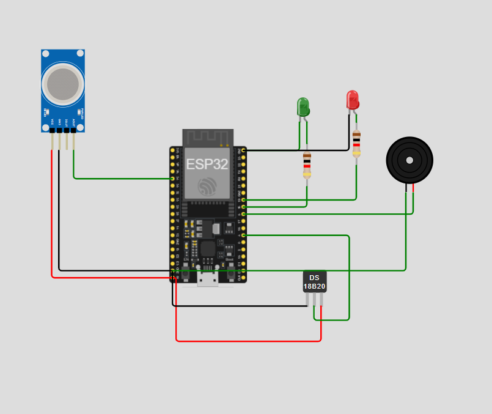
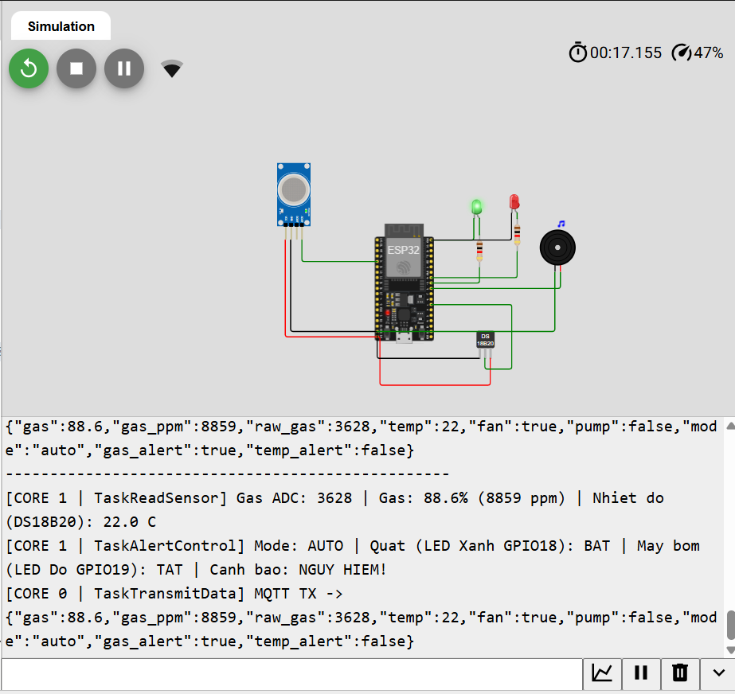
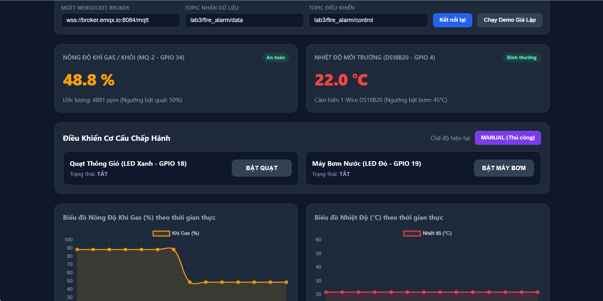
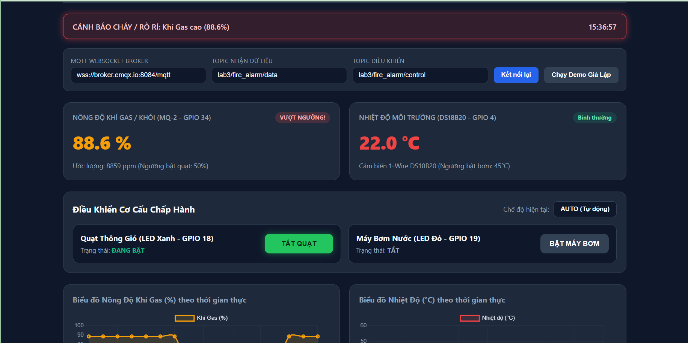

# Lab 3 - Đề 3: Thiết Kế Mạch Báo Cháy Gia Đình với ESP32, FreeRTOS và MQTT

Dự án thiết kế hệ thống **báo cháy gia đình thông minh** phát hiện rò rỉ khí gas/khói (cảm biến **MQ-2**) và nhiệt độ cao (cảm biến **DS18B20**) trên vi điều khiển **ESP32** chạy hệ điều hành thời gian thực **FreeRTOS** (đa nhân Core 0 & Core 1), truyền dữ liệu qua **MQTT Broker** và giám sát/điều khiển trực tiếp trên **Web Dashboard**.

Cấu trúc thư mục dự án gồm:
- [`wokwi/sketch.ino`](wokwi/sketch.ino) — Mã nguồn ESP32 FreeRTOS + MQTT
- [`wokwi/diagram.json`](wokwi/diagram.json) — Sơ đồ mạch Wokwi
- [`wokwi/link_wokwi.txt`](wokwi/link_wokwi.txt) — Link mô phỏng trực tiếp trên Wokwi
- [`web/index.html`](web/index.html) — Giao diện Web Dashboard theo dõi & điều khiển qua MQTT WebSocket
- [`baocao/Dương Quang Huy - 231432251.docx`](baocao/Dương%20Quang%20Huy%20-%20231432251.docx) — File báo cáo Word đầy đủ
- [`README.md`](README.md) — Tài liệu & kết quả bài Lab 3

---

## 1. Cơ sở lý thuyết

### 1.1. Ưu điểm của RTOS (Real-Time Operating System)
Hệ điều hành thời gian thực (RTOS) được thiết kế chuyên biệt cho các hệ thống nhúng yêu cầu xử lý chính xác về mặt thời gian:
- **Tính định thời (Determinism):** Đảm bảo các tác vụ quan trọng (như phát hiện cháy, kích hoạt cảnh báo) luôn được thực thi trong một khoảng thời gian giới hạn xác định trước, không bị trễ do các tác vụ phụ (như chờ kết nối mạng).
- **Đa nhiệm ưu tiên (Preemptive Multitasking):** Cho phép chia nhỏ bài toán phức tạp thành các Task độc lập với mức độ ưu tiên (Priority) rõ ràng. Task ưu tiên cao có thể chiếm quyền CPU ngay lập tức khi có sự kiện khẩn cấp.
- **Tối ưu hóa tài nguyên phần cứng:** Với các vi điều khiển đa nhân như ESP32 (2 nhân Xtensa LX6), RTOS tận dụng triệt để cả hai nhân để chạy song song tác vụ mạng và tác vụ đọc/điều khiển phần cứng.
- **Dễ bảo trì và mở rộng:** Cấu trúc phần mềm tách bạch từng module (Task), giúp phát triển, gỡ lỗi và nâng cấp tính năng mà không làm ảnh hưởng dây chuyền đến toàn bộ hệ thống.

### 1.2. Ưu điểm và nhược điểm của FreeRTOS
**Ưu điểm:**
- **Mã nguồn mở & miễn phí (MIT License):** Phổ biến rộng rãi trong công nghiệp và giáo dục, cộng đồng hỗ trợ rất lớn.
- **Nhẹ (Lightweight):** Nhân hệ điều hành chỉ chiếm vài KB RAM/Flash, cực kỳ phù hợp cho vi điều khiển nhúng như ESP32, STM32.
- **Tích hợp sẵn trong ESP-IDF / Arduino ESP32:** Hỗ trợ đầy đủ API đa nhân (`xTaskCreatePinnedToCore`), Queue, Semaphore, Mutex, Software Timer.
- **Khả năng di động cao (Portability):** Dễ dàng chuyển đổi mã nguồn giữa nhiều dòng vi điều khiển khác nhau.

**Nhược điểm:**
- **Chỉ cung cấp nhân (Kernel) cơ bản:** Không đi kèm sẵn các lớp middleware phức tạp (giao thức mạng phải dùng thêm thư viện ngoài như lwIP, PubSubClient).
- **Nguy cơ lỗi đồng bộ hóa nếu thiết kế kém:** Dễ gặp các lỗi khó gỡ như *Race Condition*, *Deadlock*, *Priority Inversion* hoặc tràn Stack (`Stack Overflow`) nếu không cấp đủ bộ nhớ hoặc không dùng cơ chế bảo vệ tài nguyên.
- **Chi phí chuyển ngữ cảnh (Context Switching Overhead):** Khi số lượng Task quá nhiều và chuyển đổi liên tục sẽ tiêu tốn một phần chu kỳ CPU và RAM cho Task Control Block (TCB).

### 1.3. Cơ chế giao tiếp và đồng bộ giữa các Task

#### a. Hàng đợi (Queue)
- **Khái niệm:** Là cơ chế truyền dữ liệu theo nguyên tắc **FIFO** (First In, First Out - vào trước ra trước) an toàn giữa các Task hoặc giữa ngắt (ISR) và Task. Dữ liệu được sao chép theo giá trị vào vùng nhớ của Queue.
- **Ưu điểm:**
  - An toàn luồng (**Thread-safe**): FreeRTOS tự động xử lý khóa truy cập khi nhiều Task đọc/ghi đồng thời.
  - Tách biệt nhà sản xuất (Producer) và nhà tiêu thụ (Consumer): `TaskReadSensor` không cần chờ mạng Wi-Fi vẫn có thể đẩy dữ liệu vào `dataQueue` và `dataAlert`.
  - Hỗ trợ cơ chế chờ không tốn CPU (**Blocking**): Task nhận có thể ngủ (`Blocked state`) cho tới khi có dữ liệu mới trong Queue.
- **Ứng dụng trong Lab:**
  - `dataQueue`: Truyền bản ghi `SensorData_t` từ `TaskReadSensor` (Core 1) sang `TaskTransmitData` (Core 0) để gửi lên MQTT Broker.
  - `dataAlert`: Truyền bản ghi `SensorData_t` từ `TaskReadSensor` (Core 1) sang `TaskAlertControl` (Core 1) để kiểm tra ngưỡng và kích hoạt Quạt/Máy bơm/Còi.

#### b. Cờ hiệu (Semaphore & Mutex)
- **Khái niệm:**
  - *Binary/Counting Semaphore:* Dùng để báo hiệu sự kiện (Signaling) hoặc đếm tài nguyên khả dụng.
  - *Mutex (Mutual Exclusion):* Một dạng Binary Semaphore đặc biệt có cơ chế kế thừa độ ưu tiên (*Priority Inheritance*), dùng để khóa độc quyền tài nguyên dùng chung.
- **Ưu điểm:**
  - Ngăn chặn xung đột dữ liệu (*Data Corruption*) và ghi đè ký tự khi nhiều Task cùng truy cập một ngoại vi (như cổng `Serial` hoặc biến trạng thái chung).
  - Giảm thiểu hiện tượng đảo ngược độ ưu tiên (*Priority Inversion*) khi dùng Mutex.
- **Ứng dụng trong Lab:**
  - `xSerialMutex`: Bảo vệ cổng giao tiếp `Serial`, tránh tình trạng log từ Core 0 và Core 1 bị trộn lẫn vào nhau trên một dòng.
  - `xControlMutex`: Bảo vệ các biến trạng thái điều khiển (`manualMode`, `manualFanState`, `manualPumpState`, `currentFanState`, `currentPumpState`) giữa `mqttCallback` (Core 0) và `TaskAlertControl` (Core 1).

---

## 2. Thiết kế phần cứng & Sơ đồ kết nối Wokwi

- **Link mô phỏng Wokwi:** https://wokwi.com/projects/480561789691719681



### Bảng kết nối chân ESP32 (khớp [`wokwi/diagram.json`](wokwi/diagram.json))

| Linh kiện | ID & Thuộc tính trên Wokwi | Nối dây chi tiết trong `diagram.json` | Chân ESP32 | Ghi chú kỹ thuật |
| :--- | :--- | :--- | :--- | :--- |
| **Cảm biến Khí Gas/Khói MQ-2** | `gas1` (`wokwi-gas-sensor`) | `gas1:VCC` → `esp:5V`<br>`gas1:GND` → `esp:GND.1`<br>`gas1:AOUT` → `esp:34` | **5V**, **GND.1**, **GPIO 34** | Kênh **ADC1_CH6** (không dùng ADC2 vì xung đột Wi-Fi trên ESP32) |
| **Cảm biến Nhiệt độ DS18B20** | `temp1` (`wokwi-ds18b20`) | `esp:5V` → `temp1:VCC`<br>`temp1:GND` → `esp:GND.1`<br>`temp1:DQ` → `esp:4` | **5V**, **GND.1**, **GPIO 4** | Giao tiếp 1-Wire (`OneWire` + `DallasTemperature`) |
| **Quạt thông gió (LED Xanh lá)** | `led2` (`color: green`, `label: "QUAT"`) + `r1` (`1000Ω`) | `led2:A` → `r1:1`, `r1:2` → `esp:18`<br>`led2:C` → `esp:GND.2` | **GPIO 18**, **GND.2** | Bật khi Gas >= 50% (Auto) hoặc nút bấm Web (Manual) |
| **Máy bơm nước (LED Đỏ)** | `led1` (`color: red`, `label: "MAY BOM"`) + `r2` (`1000Ω`) | `led1:A` → `r2:1`, `r2:2` → `esp:19`<br>`esp:GND.2` → `led1:C` | **GPIO 19**, **GND.2** | Bật khi Nhiệt độ >= 45°C (Auto) hoặc nút bấm Web (Manual) |
| **Còi báo động (Buzzer)** | `bz1` (`wokwi-buzzer`, `volume: 0.1`) | `esp:5` → `bz1:2` (+)<br>`esp:GND.1` → `bz1:1` (-) | **GPIO 5**, **GND.1** | Phát âm báo `1500Hz` khi Gas hoặc Nhiệt độ vượt ngưỡng |
| **Cổng Serial Monitor** | `$serialMonitor` | `esp:TX` → `$serialMonitor:RX`<br>`esp:RX` → `$serialMonitor:TX` | **TX**, **RX** | In log hoạt động từ Core 0 & Core 1 (`115200 baud`) |

---

## 3. Thiết kế hệ thống FreeRTOS trên ESP32

### 3.1. Bảng phân bổ các Task

| Tên Task | Hàm thực thi | Core | Độ ưu tiên (Priority) | Stack (Bytes) | Chức năng chính |
| :--- | :--- | :---: | :---: | :---: | :--- |
| **Task đọc data** | `TaskReadSensor` | **Core 1** | `2` | `4096` | Đọc MQ-2 (GPIO 34) và DS18B20 (GPIO 4) mỗi 2 giây; in log Serial; đẩy `SensorData_t` vào `dataQueue` và `dataAlert`. |
| **Task cảnh báo** | `TaskAlertControl` | **Core 1** | `3` (Cao nhất) | `4096` | Đọc dữ liệu từ `dataAlert`; kiểm tra ngưỡng Gas/Nhiệt độ (hoặc trạng thái Manual từ Web); điều khiển Quạt (GPIO 18), Máy bơm (GPIO 19), Còi (GPIO 5). |
| **Task truyền data** | `TaskTransmitData` | **Core 0** | `2` | `8192` | Kết nối & duy trì Wi-Fi (`Wokwi-GUEST`) + MQTT Broker (`broker.emqx.io`); nhận dữ liệu từ `dataQueue` gửi lên topic `lab3/fire_alarm/data`; nhận lệnh từ `lab3/fire_alarm/control`. |

### 3.2. Cấu trúc dữ liệu trao đổi (`SensorData_t`)

```cpp
typedef struct {
  int rawGas;           // Giá trị ADC thô (0 - 4095)
  float gasPercent;     // Nồng độ khí gas quy đổi (%)
  int gasPPM;           // Nồng độ khí gas ước lượng (PPM)
  float temperature;    // Nhiệt độ (°C) từ DS18B20
  uint32_t timestamp;   // Thời điểm đọc (ms)
} SensorData_t;
```

### 3.3. Kiến trúc luồng dữ liệu

```text
[Cảm biến MQ-2 (GPIO 34) + DS18B20 (GPIO 4)]
          │
          ▼
[Core 1: TaskReadSensor] ──(xSerialMutex)──► [Serial Monitor]
          │
          ├──► xQueueSend(dataAlert) ──► [Core 1: TaskAlertControl] ──► [Quạt GPIO18 / Bơm GPIO19 / Còi GPIO5]
          │                                       ▲
          │                                (xControlMutex)
          ▼                                       │
     xQueueSend(dataQueue) ──► [Core 0: TaskTransmitData] ◄──► [MQTT Broker (broker.emqx.io)]
                                                                         ▲
                                                                         │ (WSS Port 8084)
                                                                         ▼
                                                                [Web Dashboard: index.html]
```

---

## 4. Giao diện Website Giám Sát & Điều Khiển

File giao diện [`web/index.html`](web/index.html) sử dụng **HTML/CSS/JS**, **MQTT.js** (WebSocket `wss://broker.emqx.io:8084/mqtt`) và **Chart.js**:
- **2 thẻ HTML sử dụng thuộc tính `class`** hiển thị số liệu trực tiếp:
  - `<div class="sensor-value gas-value">-- %</div>` (kèm giá trị PPM).
  - `<div class="sensor-value temp-value">-- °C</div>`.
- **2 biểu đồ thời gian thực (Real-time Line Chart):** Cập nhật liên tục giá trị Khí Gas (%) và Nhiệt độ (°C) mỗi khi nhận bản tin JSON từ Broker.
- **2 nút `<button>` điều khiển cơ cấu chấp hành (Manual):**
  - `<button type="button" class="control-btn fan-btn" id="btnFan">BẬT QUẠT</button>` (LED Xanh - GPIO 18).
  - `<button type="button" class="control-btn pump-btn" id="btnPump">BẬT MÁY BƠM</button>` (LED Đỏ - GPIO 19).
  - Kèm nút chuyển đổi qua lại giữa chế độ **AUTO** và **MANUAL**, cùng nút **Chạy Demo Giả Lập** để test nhanh giao diện.

---

## 5. Giải thích mã nguồn chính ([`wokwi/sketch.ino`](wokwi/sketch.ino))

1. **Khởi tạo tại `setup()`:**
   - Khởi tạo `tempSensor.begin()` cho DS18B20 trên GPIO 4, cấu hình các chân `FAN_PIN` (18), `PUMP_PIN` (19), `BUZZER_PIN` (5).
   - Tạo 2 Mutex (`xSerialMutex`, `xControlMutex`) và 2 Queue (`dataQueue`, `dataAlert`) với độ dài 10 phần tử.
   - Dùng `xTaskCreatePinnedToCore(...)` ghim `TaskTransmitData` vào **Core 0**, `TaskReadSensor` và `TaskAlertControl` vào **Core 1**.
2. **Đọc & phân phối dữ liệu (`TaskReadSensor`):**
   - Đọc `analogRead(MQ2_PIN)` quy đổi sang `%` và `ppm`; gọi `tempSensor.requestTemperatures()` và `tempSensor.getTempCByIndex(0)` để lấy nhiệt độ từ DS18B20.
   - Khóa `xSerialMutex` để in thông số lên Serial Monitor.
   - Gửi dữ liệu vào cả `dataQueue` và `dataAlert` bằng `xQueueSend`.
3. **Cảnh báo & Điều khiển (`TaskAlertControl`):**
   - Nhận bản tin từ `dataAlert` bằng `xQueueReceive(..., pdMS_TO_TICKS(200))`.
   - Ở chế độ **Auto**: Quạt (LED Xanh GPIO 18) bật khi `gasPercent >= 50.0%`, Máy bơm (LED Đỏ GPIO 19) bật khi `temperature >= 45.0°C`.
   - Ở chế độ **Manual**: Quạt và Máy bơm bám theo trạng thái `manualFanState`, `manualPumpState` nhận từ MQTT.
   - Còi Buzzer (`GPIO 5`) phát âm `1500Hz` bất cứ khi nào phát hiện khí gas hoặc nhiệt độ vượt ngưỡng an toàn.
4. **Truyền thông Wi-Fi & MQTT (`TaskTransmitData`):**
   - Duy trì Wi-Fi (`Wokwi-GUEST`) và kết nối MQTT (`broker.emqx.io:1883`).
   - Đọc dữ liệu từ `dataQueue`, đóng gói JSON bằng `ArduinoJson` và publish lên topic `lab3/fire_alarm/data`.
   - Lắng nghe topic `lab3/fire_alarm/control` qua `mqttCallback()` để cập nhật trạng thái điều khiển từ Web.

---

## 6. Kết quả thực nghiệm & Mô phỏng

### 6.1. Kết quả mô phỏng mạch và Serial Monitor trên Wokwi



Khi chạy mô phỏng trên Wokwi ([Link project](https://wokwi.com/projects/480561789691719681)), ESP32 kết nối thành công Wi-Fi `Wokwi-GUEST` và MQTT Broker `broker.emqx.io`. Khi tăng nồng độ khí gas lên `88.6%` (`8859 ppm`, ADC `3628`) ở chế độ `AUTO`, LED Xanh (Quạt - GPIO 18) sáng, Còi Buzzer (GPIO 5) phát âm cảnh báo và Serial Monitor ghi nhận rõ hoạt động song song của 2 nhân:

```text
--------------------------------------------------
[CORE 1 | TaskReadSensor] Gas ADC: 3628 | Gas: 88.6% (8859 ppm) | Nhiet do (DS18B20): 22.0 C
[CORE 1 | TaskAlertControl] Mode: AUTO | Quat (LED Xanh GPIO18): BAT | May bom (LED Do GPIO19): TAT | Canh bao: NGUY HIEM!
[CORE 0 | TaskTransmitData] MQTT TX -> {"gas":88.6,"gas_ppm":8859,"raw_gas":3628,"temp":22,"fan":true,"pump":false,"mode":"auto","gas_alert":true,"temp_alert":false}
```

### 6.2. Giao diện Web Dashboard ở trạng thái Bình thường / Chế độ Manual



- Cảm biến MQ-2 đọc được `48.8%` (`4881 ppm` < ngưỡng `50%`) -> trạng thái **An toàn**.
- Cảm biến DS18B20 đọc được `22.0 °C` (< ngưỡng `45°C`) -> trạng thái **Bình thường**.
- Người dùng có thể chuyển sang chế độ **MANUAL (Thủ công)** để chủ động bấm nút **BẬT QUẠT** / **BẬT MÁY BƠM** gửi lệnh JSON xuống ESP32 qua topic `lab3/fire_alarm/control`.

### 6.3. Giao diện Web Dashboard khi Cảnh báo Rò rỉ Khí Gas (Chế độ Auto)



- Khi nồng độ khí gas tăng lên `88.6%` (`8859 ppm` >= `50%`), banner cảnh báo đỏ **CẢNH BÁO CHÁY / RÒ RỈ: Khí Gas cao (88.6%)** tự động xuất hiện cùng nhãn **VƯỢT NGƯỠNG!**.
- Ở chế độ **AUTO (Tự động)**, hệ thống tự động kích hoạt **Quạt Thông Gió (LED Xanh - GPIO 18)** sang trạng thái **ĐANG BẬT** và đồng bộ tức thời lên biểu đồ thời gian thực.

### 6.4. Bảng tổng hợp kết quả kiểm thử các kịch bản

| Kịch bản kiểm thử | Giá trị đầu vào | Chế độ | Quạt (GPIO 18) | Máy bơm (GPIO 19) | Còi Buzzer (GPIO 5) | Hiển thị trên Web Dashboard |
| :--- | :--- | :---: | :---: | :---: | :---: | :--- |
| **Bình thường** | Gas `< 50%` (`48.8%`), Nhiệt độ `< 45°C` (`22.0°C`) | `AUTO` | TẮT | TẮT | TẮT | Thẻ hiển thị **An toàn** / **Bình thường** |
| **Rò rỉ Khí Gas** | Gas `>= 50%` (`88.6%`), Nhiệt độ `< 45°C` (`22.0°C`) | `AUTO` | **BẬT** | TẮT | **Kêu `1500Hz`** | Banner **CẢNH BÁO**, Gas **VƯỢT NGƯỠNG!**, Quạt **ĐANG BẬT** |
| **Nhiệt độ cao** | Gas `< 50%`, Nhiệt độ `>= 45°C` | `AUTO` | TẮT | **BẬT** | **Kêu `1500Hz`** | Banner **CẢNH BÁO**, Nhiệt độ **VƯỢT NGƯỠNG!**, Bơm **ĐANG BẬT** |
| **Điều khiển từ xa** | Nhấn nút `BẬT QUẠT` / `BẬT MÁY BƠM` trên Web | `MANUAL` | Theo nút Web | Theo nút Web | Kêu khi vượt ngưỡng | Chuyển badge sang **MANUAL (Thủ công)**, đồng bộ trạng thái |
